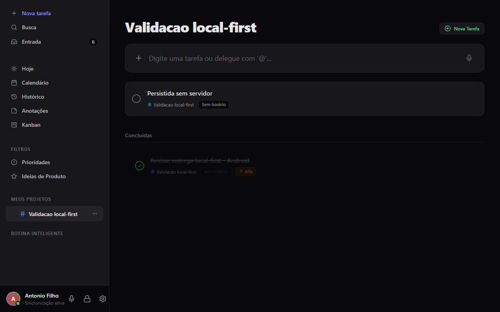
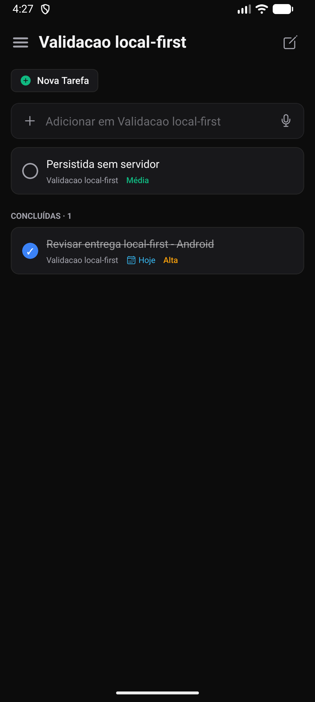

# Persistência cifrada e sincronização desktop ↔ mobile

## Problema e comportamento

O SQLite do mobile guardava tarefas em claro. No desktop, registros e outbox eram gravados separadamente e erros de disco podiam ser ocultados. Um envelope inválido também podia ser ignorado enquanto o cursor avançava, perdendo a oportunidade de recebê-lo novamente.

Agora o mobile confirma a operação somente depois de persistir o snapshot cifrado. No desktop, a interface continua otimista, mas mostra a gravação pendente, expõe falhas e permite tentar novamente; criar/editar/excluir só exibe sucesso após `store.flushed()`. A sincronização usa dados duráveis e mantém alterações pendentes até a confirmação do servidor.

## Implementação

- **Mobile:** consultas SQLite em memória; cada transação com alterações serializa o banco inteiro e grava um snapshot AES-256-GCM em `reminder-encrypted.db`. Chave aleatória de 256 bits no SecureStore, separada do banco. O snapshot inclui entidades, exclusões lógicas, rascunhos, outbox e cursor. Falha de persistência restaura a versão anterior em memória e não publica sucesso.
- **Migração:** copia o SQLite anterior, aplica migrações e confirma o snapshot cifrado antes de remover o banco antigo e seus arquivos auxiliares. Chave ausente ou autenticação inválida interrompe a abertura sem substituir os dados.
- **Desktop:** registros completos cifrados com a chave do cofre; registros, outbox e cursor confirmados em uma única transação IndexedDB com durabilidade estrita. Leitura inicial também em uma única transação. Revisão de disco impede uma segunda aba de sobrescrever silenciosamente um snapshot mais recente. Use uma aba por cofre; perfis/dispositivos diferentes sincronizam pelo servidor.
- **Transporte:** envelopes AES-256-GCM autenticam também entidade, ID, data e exclusão via AAD. Envelope inválido invalida a página inteira; cursor não avança. O servidor precisa confirmar cada item antes de remover sua pendência.
- **Conflitos:** última versão por registro; timestamps locais de tarefas são monotônicos, inclusive se o relógio retrocede. Empates convergem para a versão aceita pelo servidor. Campos exclusivos do desktop, como tags, são preservados. Não há fusão colaborativa de texto/CRDT.
- **Tempo real:** consulta HTTP longa autenticada (`GET /api/sync/changes`) notifica mudança de cursor; clientes fazem pull imediatamente. Servidor verifica alterações a cada 250 ms; envio local tem debounce de 600 ms no desktop e 800 ms no mobile. Polling de 3/5 segundos recupera falhas. Mobile suspende a espera em segundo plano.
- **Pareamento mobile:** chave e endereço juntos em um item seguro, com migração de credenciais anteriores. Falha ao substituir mantém o pareamento anterior.

## Executar localmente

Use os PRs correspondentes de `ArtNSchmidt/reminderMobile` e `Antoniosn4/reminderone`. O backend pertence ao desktop. Gemini/Whisper não são necessários para CRUD e sincronização.

Desktop, PowerShell, um terminal para cada processo:

```powershell
npm install
python -m venv server/.venv
server/.venv/Scripts/python -m pip install -r server/requirements.txt
server/.venv/Scripts/python -m uvicorn main:app --app-dir server --host 0.0.0.0 --port 8010
```

```powershell
$env:REMINDER_API_TARGET='http://127.0.0.1:8010'
$env:VITE_REMINDER_API_ORIGIN='http://127.0.0.1:8010'
npm run dev -- --host 127.0.0.1 --port 5173
```

Abra `http://127.0.0.1:5173`, crie o PIN e ative a sincronização em Configurações. Para Tauri empacotado, consulte o README do desktop; o sidecar usa a porta 8000.

Mobile, Expo Go compatível com SDK 57 e emulador Android:

```powershell
npm install
$env:EXPO_PUBLIC_API_BASE_URL='http://10.0.2.2:8010'
$env:REACT_NATIVE_PACKAGER_HOSTNAME='127.0.0.1'
npx expo start --lan --port 8082
```

Em outro terminal, com adb no PATH:

```powershell
adb reverse tcp:8082 tcp:8082
adb shell am start -a android.intent.action.VIEW -d exp://127.0.0.1:8082
```

No emulador, use o código do desktop com endereço `http://10.0.2.2:8010`. Em telefone físico, use o IP LAN do computador e a porta do backend, ambos na mesma rede. O QR/código contém a chave: não publique seu conteúdo. O backend precisa estar acessível para transferir alterações; cada app funciona offline e converge ao reconectar. Não há nuvem nem execução garantida do mobile em segundo plano.

## Evidências e testes

Validação em Windows, Android API 36.1/Expo Go e frontend desktop no Chrome:

- Criar tarefa/projeto pela interface desktop e recebê-los no Android.
- Editar título no Android e recebê-lo no desktop.
- Desligar backend, criar tarefa no Android, encerrar Expo Go e reabrir: tarefa preservada.
- Criar tarefa no desktop sem backend, recarregar e desbloquear PIN: tarefa preservada.
- Religar backend: tarefa offline do Android recebida pelo desktop.
- Teste integrado usa os dois motores reais, SQLite de teste e criptografia compatível: CRUD, conclusão, exclusão, edições offline, campos extras e reabertura.
- Testes de falha de disco, rollback, retry, adulteração de ciphertext/AAD, outbox e cursor.

```powershell
# Mobile
npm test
npm run typecheck
npm run lint
# Desktop
npm test
npm run build
server/.venv/Scripts/python -m pytest server/tests -q
# Integração na raiz do desktop; ajuste o caminho do mobile
$env:REMINDER_MOBILE_PATH=(Resolve-Path '../reminderMobile').Path
node node_modules/vitest/vitest.mjs run tests/crossDevice.integration.test.js
```

Prints reais: frontend atual executado na janela Tauri de desenvolvimento (WebView2) e Android no Expo Go/emulador. Também foi testado no Chrome. O executável Tauri de desenvolvimento já existente carrega o frontend Vite atual; o backend desta validação roda separadamente na porta 8010. O instalador de produção não foi recompilado e o iOS não foi validado nesta rodada.

Resultado: 189 testes mobile, 73 testes desktop (incluindo integração entre motores) e 37 testes backend passaram; typecheck, lint e build Vite passaram. No IndexedDB real também foram verificados ciphertext sem o título em claro, reabertura e recusa de uma escrita feita por uma aba com revisão antiga. Pela interface, conclusão e exclusão no Android chegaram ao desktop.





## Limites técnicos

Snapshots completos priorizam atomicidade e compatibilidade com Expo Go: memória, cifragem e escrita crescem com o banco. Para grandes volumes, avaliar SQLCipher/build nativo ou persistência cifrada incremental. O PIN visual mobile ainda não é a chave do banco: proteção em repouso usa a chave do sistema operacional. Excluir arquivos legados não garante apagamento forense em flash/backups. Desinstalar o app ou perder a chave pode tornar o banco irrecuperável.

O servidor vê metadados (IDs, entidades, horários, exclusões), mas não conteúdos cifrados. HTTP é usado na LAN de desenvolvimento; acesso remoto deve usar HTTPS ou túnel autenticado para proteger o token de transporte. Chamadas opcionais de IA/voz têm política própria e não fazem parte da garantia de conteúdo cifrado da sincronização.
